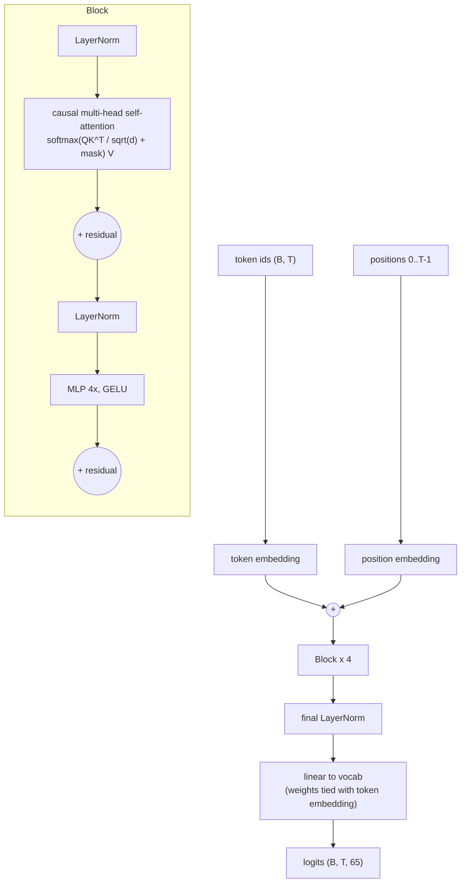

# Tiny GPT from Scratch

A small **GPT-style decoder-only transformer** written from scratch in PyTorch (no `nn.Transformer`, no Hugging Face), trained on a CPU to write Shakespeare-like text.
Hand-written multi-head causal self-attention, pre-norm residual blocks, weight tying, AdamW with warmup + cosine decay, gradient clipping, checkpointing, a **KV cache** for fast generation, and temperature / top-k / top-p sampling.

```text
$ python -m tinygpt.sample --prompt "ROMEO:" --temperature 0.8 --top-k 40

ROMEO:
Away, and that was shall be like Richard's mind
With his graving the lady divined strike
His lives a giddle prizent of my helmen.
And incertake wife are the present of York,
```

It learned the format (speaker names, line breaks, iambic-ish rhythm, real English words) from raw characters in about 30 minutes on a laptop CPU. It does not "make sense" because it is 818K parameters, about 200,000 times smaller than GPT-3.

## Training run

| setting | value |
|---|---|
| data | Tiny Shakespeare, 1.1M characters, 90/10 train/val split |
| tokenizer | character-level, 65 tokens |
| model | 4 layers, 4 heads, 128-dim embeddings, context 128, **818K parameters** |
| optimiser | AdamW (betas 0.9/0.95, weight decay 0.1 on matrices only), LR 3e-3, 100 warmup steps, cosine decay to 3e-4, grad clip 1.0 |
| batch | 32 sequences x 128 characters, 3,000 steps |
| hardware | laptop CPU, ~29 minutes |

| step | train loss | val loss |
|---|---|---|
| 0 | 4.17 (= ln 65, random guessing) | 4.17 |
| 500 | 1.97 | 2.06 |
| 1000 | 1.61 | 1.80 |
| 2000 | 1.42 | 1.60 |
| 3000 | **1.35** | **1.56** |

The gap between train and val loss stays small, so the model is not just memorising; dropout 0.1 and weight decay help. The best checkpoint (lowest val loss) is the one saved.

## Architecture



- **Self-attention**: every position makes a query, key and value. Scores `Q K^T / sqrt(d)` say how much each earlier character matters; softmax turns them into weights; the output is a weighted mix of values. Written out by hand in `model.py`, and a test checks it matches PyTorch's fused `scaled_dot_product_attention`.
- **Causal mask**: a lower-triangular mask sets future positions to minus infinity before softmax, so the model can't cheat by looking ahead. A test changes future tokens and checks earlier outputs don't change.
- **Multi-head**: 4 heads of 32 dims each look for different patterns in parallel, then get concatenated.
- **Pre-norm residual blocks**: `x + attn(LN(x))` and `x + mlp(LN(x))` keep gradients flowing in deeper networks.
- **Weight tying**: the output layer reuses the input embedding matrix (fewer parameters, usually better).
- **GPT-2 init trick**: layers that write into the residual stream start smaller (`0.02 / sqrt(2 * n_layer)`).

## Generation

- **Temperature**: divide logits before softmax. Below 1 = safer, above 1 = wilder; 0 = always the top token (greedy).
- **Top-k**: only sample from the k most likely tokens.
- **Top-p (nucleus)**: only sample from the smallest set of tokens whose probabilities add up to p.
- **KV cache**: without it, every new token re-runs attention over the whole context. With it, keys and values of earlier tokens are stored and only the new token is processed.

```text
$ python scripts/bench_kv_cache.py --tokens 500
use_cache=False ->     318 tokens/sec
use_cache=True  ->     553 tokens/sec
speed-up: 1.7x | identical within the first context window: True
```

The speed-up grows with context length; with a 128-character window recomputing is still cheap. Because position embeddings are absolute, when the window fills up the cache is rebuilt from the last half window.

## Quick start

```bash
git clone https://github.com/nitishfound/tiny-gpt.git
cd tiny-gpt
pip install torch --index-url https://download.pytorch.org/whl/cpu   # or a CUDA build
pip install -r requirements.txt
python scripts/download_data.py
python -m tinygpt.train --steps 3000          # writes out/ckpt.pt and out/log.csv
python -m tinygpt.sample --prompt "JULIET:" --temperature 0.8 --top-k 40
pytest -q
```

## Project structure

```
tinygpt/
  model.py       attention, MLP, block, GPT, generate (KV cache), sampling
  data.py        character tokenizer, train/val split, random batches
  train.py       training loop: AdamW, LR schedule, grad clipping, eval, checkpoints
  sample.py      text generation CLI
  checkpoint.py  save/load (weights_only=True: never unpickles arbitrary objects)
scripts/         download data, KV cache benchmark
tests/           15 tests: shapes, causality, attention vs PyTorch, weight tying,
                 overfit one batch, KV cache equality, sampling, LR schedule, training run
```

## What I would do next

- Use my BPE tokenizer instead of characters (shorter sequences, more context per token).
- Rotary position embeddings (RoPE), which make the KV cache work across a sliding window.
- Mixed precision and `torch.compile` on a GPU, then scale to ~10M parameters.

## License

MIT
